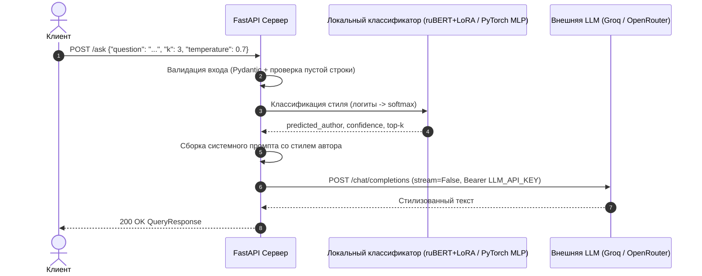

# Literary Style Assistant

Двухстадийный микросервис определения литературного стиля русских классиков (**64 автора**) и стилизованной генерации текста на базе **PyTorch**, **ruBERT + LoRA (PEFT)**, **FastAPI** и **Docker**.

---

## 1. Архитектура и поток данных

1. **Запрос клиента (`POST /ask`)** — произвольный литературный фрагмент или пользовательский вопрос.
2. **Стадия 1 — Локальный нейросетевой классификатор стиля:**
   * Текст очищается и разбивается по границам слов на фрагменты ~1000 символов; для каждого фрагмента вычисляются логиты по всем **64 авторам** из датасета [`ViliamVolosV/russian_classic_literature`](https://huggingface.co/datasets/ViliamVolosV/russian_classic_literature) (без урезания классов).
   * Усреднение `softmax`-распределений по фрагментам даёт предсказанного автора (`predicted_author`) и оценку уверенности (`confidence`).
   * Поддерживаются два локальных бэкенда (`CLASSIFIER_BACKEND`):
     * `lora` *(по умолчанию)* — дообученный трансформер `ai-forever/ruBert-base` с адаптером LoRA (`r=16, alpha=32`);
     * `baseline` — посимвольный TF-IDF (`char` n-граммы `(2, 4)`, 50 000 признаков, без лемматизации) + полносвязная сеть `PyTorch MLP`.
3. **Стадия 2 — Стилизованная генерация через внешний LLM API:**
   * Динамически формируется системный промпт стилизатора под найденного автора.
   * Асинхронный клиент (`httpx.AsyncClient`) обращается к OpenAI-совместимому API **Groq Cloud** (`llama-3.1-8b-instant`) или **OpenRouter** (`meta-llama/llama-3.3-70b-instruct:free`).



---

## 2. Структура репозитория

```text
literary-style-assistant/
├── .gitignore
├── .dockerignore
├── .env.example
├── Dockerfile
├── requirements.txt
├── README.md
├── REPORT.md                        # Аналитический отчёт и сравнение моделей
│
├── data/                            # Игнорируется Git (.gitignore)
│   ├── raw/                         # train_dataset.json, validation_dataset.json, test_dataset.json
│   └── processed/                   # parsed_*.parquet, chunks_*.parquet
│
├── models/                          # Артефакты векторизации и веса моделей
│   ├── tfidf_vectorizer.pkl         # Обученный char TF-IDF векторизатор (без лемматизации)
│   ├── label_encoder.pkl            # LabelEncoder на 64 автора
│   ├── baseline_pytorch.pt          # Чекпоинт PyTorch MLP (state_dict)
│   └── lora_classifier/             # Веса и конфигурация LoRA-адаптера + токенизатор
│
├── notebooks/                       # Воспроизводимые исследовательские ноутбуки
│   ├── 01_eda_and_cleaning.ipynb
│   ├── 02_tfidf_experiments.ipynb
│   ├── 03_pytorch_baseline.ipynb
│   └── 04_lora_finetuning.ipynb
│
├── reports/                         # Графики обучения, матрицы ошибок и сводки метрик
│   └── figures/
│
├── src/                             # Продакшен-модули микросервиса
│   ├── __init__.py
│   ├── preprocessing.py             # Очистка, нормализация и нарезка текста
│   ├── config.py                    # Настройки окружения (pydantic-settings)
│   ├── schemas.py                   # Pydantic-модели запросов и ответов
│   ├── classifier.py                # Инференс PyTorch Baseline и ruBERT + LoRA
│   ├── llm_client.py                # Асинхронный клиент Groq / OpenRouter с ретраями
│   └── app.py                       # FastAPI приложение, lifespan, /health, /classify, /ask
│
└── tests/
    └── test_service.py              # Модульные и интеграционные тесты сервиса
```

---

## 3. Быстрый старт (локально)

### Установка окружения (Python 3.11)

```powershell
# Создание виртуального окружения через uv (или python -m venv .venv)
uv venv --python 3.11 .venv

# Для обучения и GPU-инференса на NVIDIA RTX (CUDA 12.8):
uv pip install --python .venv\Scripts\python.exe torch --index-url https://download.pytorch.org/whl/cu128
uv pip install --python .venv\Scripts\python.exe -r requirements.txt
```

### Безопасная настройка API-ключа внешней LLM

Ключ **никогда** не хранится в коде или Docker-образе. Поддерживаются ключи:
* **Groq Cloud** (`gsk_...`, консоль: https://console.groq.com/keys) — автоматически выбирается модель `llama-3.1-8b-instant`;
* **OpenRouter** (`sk-or-...`, консоль: https://openrouter.ai/keys) — автоматически выбирается бесплатная модель `meta-llama/llama-3.3-70b-instruct:free`.

Создайте файл `.env` в корне проекта (он добавлен в `.gitignore` и `.dockerignore`) или передайте переменную окружения перед запуском:

```powershell
$env:LLM_API_KEY = "your_api_key_here"
.venv\Scripts\uvicorn.exe src.app:app --host 0.0.0.0 --port 8000
```

---

## 4. Запуск в Docker

Сборка образа использует кэширование слоёв зависимостей и предзагрузку базового энкодера `ruBert-base`, а также исключает сырые данные, ноутбуки и `.env` через `.dockerignore`:

```bash
docker build -t doc-assistant .
docker run --rm -p 8000:8000 -e LLM_API_KEY="your_api_key_here" doc-assistant
```

Переключение классификатора при необходимости (по умолчанию `lora`):

```bash
docker run --rm -p 8000:8000 -e LLM_API_KEY="your_api_key_here" -e CLASSIFIER_BACKEND="baseline" doc-assistant
```

---

## 5. Эндпоинты и примеры запросов

После старта интерактивная документация Swagger UI доступна по адресу `http://localhost:8000/docs`.

### `GET /health` — проверка готовности

```bash
curl http://localhost:8000/health
```

```json
{"status": "ok", "model_loaded": true}
```

### `POST /ask` — определение стиля и генерация ответа

```bash
curl -X POST http://localhost:8000/ask \
  -H "Content-Type: application/json" \
  -d '{"question": "Какая прекрасная ночь над Невой...", "k": 3, "temperature": 0.7}'
```

Пример в PowerShell:

```powershell
Invoke-RestMethod -Method Post -Uri "http://localhost:8000/ask" `
  -ContentType "application/json; charset=utf-8" `
  -Body '{"question": "Какая прекрасная ночь над Невой...", "k": 3, "temperature": 0.7}'
```

Ответ `200 OK`:

```json
{
  "predicted_author": "Достоевский Ф",
  "confidence": 0.8942,
  "model_name": "rubert-base-lora",
  "generated_text": "..."
}
```

### `POST /classify` — локальная диагностика стиля (без внешнего API-ключа)

Позволяет протестировать локальный классификатор и распределение вероятностей `top-k` авторов автономно:

```bash
curl -X POST http://localhost:8000/classify \
  -H "Content-Type: application/json" \
  -d '{"question": "Какая прекрасная ночь над Невой...", "k": 5}'
```

---

## 6. Проверка тестов и воспроизведение экспериментов

```powershell
# Запуск модульных и API-тестов
.venv\Scripts\python.exe -m unittest discover -s tests -v
```

Исследовательский конвейер полностью воспроизводится последовательным выполнением ноутбуков в директории `notebooks/`:
1. `01_eda_and_cleaning.ipynb` — скачивание датасета, регулярные выражения парсинга `messages`, очистка, EDA и экспорт в `data/processed/`.
2. `02_tfidf_experiments.ipynb` — сравнение пайплайнов с лемматизацией (`pymorphy3`) и без неё, Grid Search посимвольного TF-IDF, сохранение `models/tfidf_vectorizer.pkl` и `models/label_encoder.pkl`.
3. `03_pytorch_baseline.ipynb` — обучение `TextClassifier` (`Linear -> ReLU -> Linear`, сырые логиты без `Softmax`) на 20 эпохах, чекпоинт `models/baseline_pytorch.pt`.
4. `04_lora_finetuning.ipynb` — тонкая настройка `ai-forever/ruBert-base` с LoRA (`peft`) в BF16, матрица ошибок по всем авторам и сохранение `models/lora_classifier/`.
