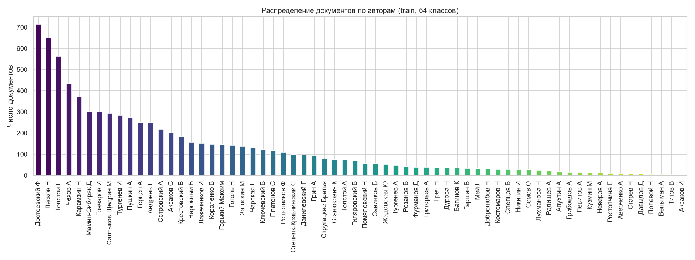
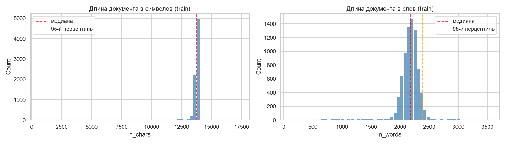
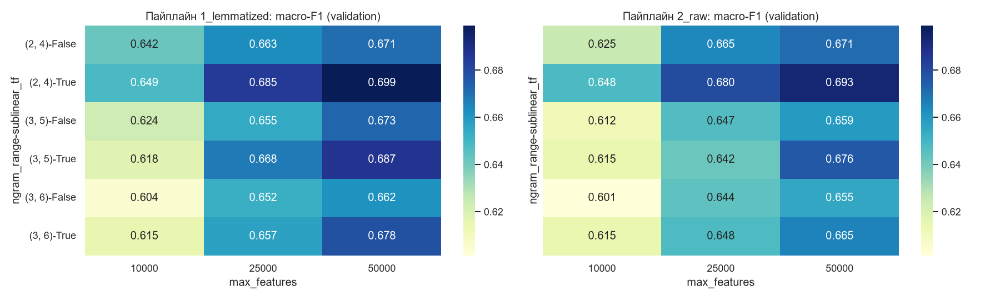
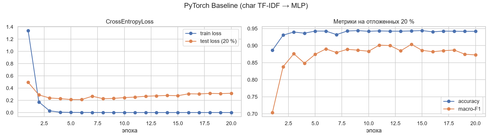
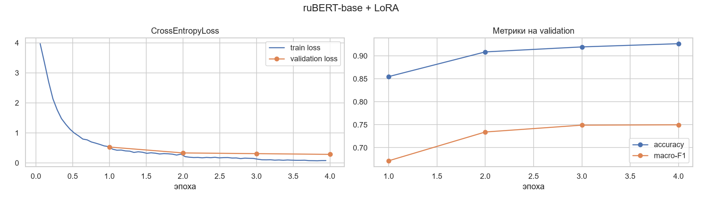
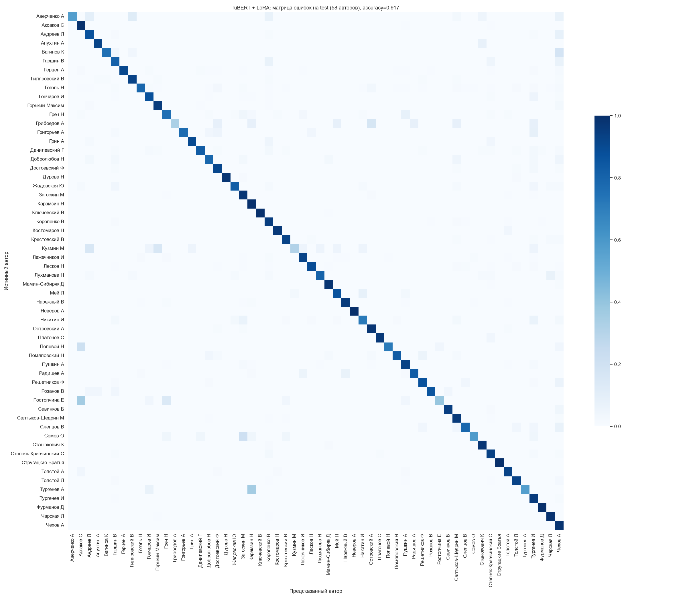
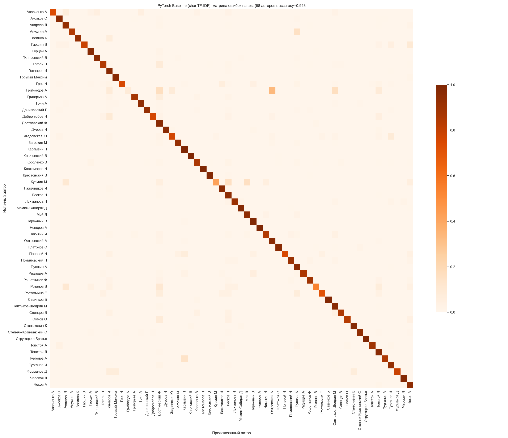

# Полный технический и аналитический отчёт по проекту Literary Style Assistant

**Оборудование и среда экспериментов:** AMD Ryzen 7 7700 (8 ядер / 16 потоков), 31 ГБ RAM, NVIDIA GeForce RTX 5070 (12 ГБ VRAM, архитектура Blackwell `sm_120`, CUDA 12.8), Python 3.11.18, PyTorch `2.11.0+cu128`.

---

## 1. Постановка задачи и анализ исходных данных (EDA)

Разработан двухстадийный микросервис атрибуции литературного стиля и управляемой стилизованной генерации:
1. **Стадия 1 (локальная модель):** классификация стиля входного текста по полному набору из **64 русских классиков** корпуса [`ViliamVolosV/russian_classic_literature`](https://huggingface.co/datasets/ViliamVolosV/russian_classic_literature) без какого-либо урезания классов.
2. **Стадия 2 (внешний LLM API):** генерация продолжения или ответа через OpenAI-совместимый API (**Google AI Studio**, **Groq Cloud**, **OpenRouter**) с динамическим системным промптом под предсказанного автора.

### 1.1. Аудит шаблонов парсинга и очистки (`notebooks/01_eda_and_cleaning.ipynb`)

Исходные файлы (`train_dataset.json`, `validation_dataset.json`, `test_dataset.json`) записаны в формате JSON Lines и содержат диалоги `messages` (`system`, `user`, `assistant`). При анализе реплик `role="user"` выявлены четыре шаблона:

| Шаблон реплики `user` | Кол-во в `train` | Доля | Покрывается regex из ТЗ `стиле автора ([^\"]+)` |
|---|---:|---:|---|
| `«Придумай отрывок из книги … автора {Author}»` | 3 258 | 40.6 % | Нет |
| `«Напиши текс в стиле автора {Author}»` | 1 636 | 20.4 % | Да |
| `«Придумай текс похожий на текст автора {Author}»` | 1 598 | 19.9 % | Нет |
| `«Напиши текс похожий на текст автора {Author}»` | 1 526 | 19.0 % | Нет |
| **Итого** | **8 018** | **100.0 %** | **20.4 % (без fallback) -> 100.0 % (с fallback)** |

Введение двухуровневого извлечения (`AUTHOR_RE_PRIMARY` + `AUTHOR_RE_FALLBACK = r"автора\s+([^\"]+?)\s*$"`) позволило сохранить **100 % записей и все 64 автора**. При очистке отфильтрована единственная пустая запись (`train_06338`, `0` символов), устранены буквальные экранирования, управляющие и невидимые символы (`\u200b`, `\ufeff`), проверено отсутствие дубликатов и пересечений между выборками (`train ∩ validation = 0`, `train ∩ test = 0`, `validation ∩ test = 0`).

### 1.2. Статистика выборок и дисбаланс классов

| Выборка | Документов | Фрагментов (~1000 симв.) | Уникальных авторов | Среднее / медиана / p95 символов | Среднее / медиана / p95 слов |
|---|---:|---:|---:|---:|---:|
| `train` | 8 017 | 110 285 | 64 | 13 499 / 13 756 / 13 857 | 2 153 / 2 178 / 2 380 |
| `validation` | 708 | 9 735 | 52 | 13 488 / 13 755 / 13 855 | 2 153 / 2 177 / 2 372 |
| `test` | 708 | 9 748 | 58 | 13 515 / 13 757 / 13 850 | 2 152 / 2 181 / 2 371 |

* **Несбалансированность:** от `714` документов (*Достоевский Ф*, `9 907` фрагментов) до `1` документа (*Аксаков И*, `7` фрагментов), коэффициент дисбаланса `714:1`; топ-10 авторов формируют `52.1 %` выборки, 13 авторов имеют менее 20 документов.
* **Декомпозиция на фрагменты ~1000 символов:** исходные записи — равномерные книжные блоки по ~13.8 тыс. символов. Нарезка по границам слов на фрагменты ~1000 символов (медиана `242` токена `ruBert-base`) приближает обучающее распределение к реальным пользовательским запросам, кратно расширяет выборку для малых классов и позволяет на длинных текстах усреднять вероятности `softmax` по фрагментам.

---

## 2. Эксперименты с посимвольным TF-IDF и Grid Search (`notebooks/02_tfidf_experiments.ipynb`)

Исследованы 36 конфигураций (`analyzer="char"`): 2 пайплайна предобработки (с морфологической лемматизацией `pymorphy3` и по сырому очищенному тексту) × `ngram_range ∈ {(2,4), (3,5), (3,6)}` × `max_features ∈ {10 000, 25 000, 50 000}` × `sublinear_tf ∈ {True, False}`.

| Ранг | Пайплайн | `ngram_range` | `max_features` | `sublinear_tf` | Val Accuracy | Val Macro-F1 | Оверхед лемматизации |
|---:|---|---|---:|---|---:|---:|---:|
| 1 | `1_lemmatized` (`pymorphy3`) | `(2, 4)` | 50 000 | `True` | **0.8464** | **0.6989** | `+1.88 мс / запрос` |
| 2 | **`2_raw` (выбран в продакшен)** | **`(2, 4)`** | **50 000** | **`True`** | **0.8404** | **0.6934** | **`0.00 мс`** |
| 3 | `1_lemmatized` (`pymorphy3`) | `(3, 5)` | 50 000 | `True` | 0.8356 | 0.6872 | `+1.88 мс / запрос` |
| 4 | `1_lemmatized` (`pymorphy3`) | `(2, 4)` | 25 000 | `True` | 0.8310 | 0.6850 | `+1.88 мс / запрос` |
| 5 | `2_raw` (без лемматизации) | `(2, 4)` | 25 000 | `True` | 0.8232 | 0.6796 | `0.00 мс` |

**Аналитическое обоснование выбора:**
* Диапазон `(2, 4)` превосходит `(3, 5)` и `(3, 6)` за счёт захвата флексий, служебных частиц и авторской пунктуации без переобучения на корни имён собственных конкретных романов.
* Масштабирование `sublinear_tf=True` добавляет `+2.2 п.п.` Macro-F1 (`0.6934` против `0.6711`).
* Отказ от лемматизации в продакшене устраняет почти трёхкратное замедление предобработки (`1.02 мс` чистой векторизации против `2.90 мс` с `pymorphy3`) при разнице Macro-F1 всего `0.55 п.п.`. Размер `models/tfidf_vectorizer.pkl` — **`1.56 МБ`**.

---

## 3. Нейросетевой Baseline на PyTorch (`notebooks/03_pytorch_baseline.ipynb`)

Обучена двухслойная сеть `TextClassifier` (`Linear(50000, 128) -> ReLU -> Linear(128, 64)`, `6 408 384` параметров), возвращающая **сырые логиты без `Softmax`** в `nn.CrossEntropyLoss()`.

* Валидационный разрез 80 % / 20 % (`random_state=42`) построен группировкой по книгам (`GroupShuffleSplit`, `88 202` train / `22 083` holdout-фрагмента, пересечение документов `0`).
* За 20 эпох (`Adam(lr=1e-3)`, `batch_size=32`, конвертация CSR-строк в плотные батчи на лету) `Train Loss` монотонно снизился с `1.3386` до `0.0001` за `2.6 мин`. Пик качества на отложенных 20 % составил `Macro-F1 = 0.9036` (14-я эпоха), финальное значение на 20-й эпохе — `Accuracy = 94.18 %`, `Macro-F1 = 87.26 %`.
* На независимой выборке `test` достигнуты **Accuracy `94.35 %` (`Macro-F1 = 88.67 %`)** по фрагментам и **Accuracy `99.29 %` (`Macro-F1 = 96.85 %`)** по полным документам. Веса сохранены через `state_dict` в `models/baseline_pytorch.pt` (`24.45 МБ` чистых весов модели, `73.35 МБ` вместе с состояниями `Adam`).

---

## 4. Трансформер `ruBERT-base` + LoRA (`notebooks/04_lora_finetuning.ipynb`)

Выполнена тонкая настройка `ai-forever/ruBert-base` с адаптером LoRA (`TaskType.SEQ_CLS`, `r=16`, `lora_alpha=32`, `target_modules=["query", "value", "dense"]`, `lora_dropout=0.1`) в формате **BF16** на RTX 5070:

* Обучаемых параметров: **`2 433 088` из `180 789 632` (`1.35 %`)**. Вес сохранённого адаптера `models/lora_classifier/adapter_model.safetensors` — **`9.30 МБ`** (против `680.4 МБ` базовой модели в FP32, сжатие хранимого чекпоинта в **73 раза**).
* Сходимость на `validation` (`batch_size=64`, `lr=3e-4`, пик VRAM `8.6 ГБ`, `52.0 мин`):
  * Эпоха 1: `val_loss = 0.5269`, `Accuracy = 85.48 %`, `Macro-F1 = 67.15 %`
  * Эпоха 2: `val_loss = 0.3312`, `Accuracy = 90.85 %`, `Macro-F1 = 73.42 %`
  * Эпоха 3: `val_loss = 0.3071`, `Accuracy = 91.94 %`, `Macro-F1 = 74.91 %`
  * Эпоха 4: `val_loss = 0.2832`, `Accuracy = 92.63 %`, `Macro-F1 = 74.98 %`
* На выборке `test` достигнуты **Accuracy `91.72 %` (`Macro-F1 = 85.07 %`)** по фрагментам и **Accuracy `99.15 %` (`Macro-F1 = 98.53 %`)** по полным документам (`702` из `708` документов классифицированы верно среди 58 авторов).

**Литературоведческая интерпретация матрицы ошибок:** единичные несовпадения возникают исключительно между авторами одной исторической школы и жанра при малом числе обучающих текстов: *Тургенев А -> Карамзин Н* (круг «Арзамаса» начала XIX века), *Грибоедов А -> Островский А* (драматургия), *Ростопчина Е / Полевой Н -> Аксаков С* (проза 1830–1840-х), *Аверченко А -> Гиляровский В* (городской очерк и фельетон).

---

## 5. Сводное сравнение локальных классификаторов

| Показатель | PyTorch Baseline (`char` TF-IDF + MLP) | `ruBERT-base` + LoRA (`r=16, alpha=32`) |
|---|---|---|
| **Обучаемых параметров** | `6 408 384` (100 %) | **`2 433 088`** (`1.35 %` от `180.8M`) |
| **Размер весов модели** | `24.45 МБ` (+`1.56 МБ` TF-IDF; `73.35 МБ` с `Adam`) | **`9.30 МБ`** адаптер (+`680.4 МБ` базовый энкодер в кэше) |
| **Время обучения (RTX 5070)** | **2.6 мин** (20 эпох) | 52.0 мин (4 эпохи, BF16) |
| **Test Accuracy / Macro-F1 (фрагменты ~1000 симв.)** | **94.35 % / 88.67 %** | 91.72 % / 85.07 % |
| **Test Accuracy / Macro-F1 (полные документы)** | **99.29 %** / 96.85 % | 99.15 % / **98.53 %** |
| **Accuracy / Macro-F1 на 100 симв.** | **41.3 % / 31.0 %** | 33.8 % / 24.2 % |
| **Accuracy / Macro-F1 на 250 симв.** | **66.2 % / 55.5 %** | 59.3 % / 45.9 % |
| **Accuracy / Macro-F1 на 500 симв.** | **83.1 % / 73.2 %** | 79.5 % / 69.7 % |
| **Латентность 1 запроса на GPU (RTX 5070)** | **1.34 мс** | 8.13 мс |
| **Латентность 1 запроса на CPU (Ryzen 7 7700)** | **1.99 мс** | 84.48 мс |

**Вывод:** символьный TF-IDF `(2,4)` обладает высокой чувствительностью к микростилевым маркерам (пунктуация, частицы, суффиксы) по всему окну 1000 символов (тогда как окно `ruBert-base` в 256 токенов усекает хвост у `29.7 %` фрагментов) и обеспечивает минимальную задержку на CPU (`1.99 мс`). В свою очередь, `ruBERT-base + LoRA` при агрегации по произведению выигрывает **`+1.68 п.п.` по Macro-F1 (`98.53 %` против `96.85 %`)** за счёт лучшего обобщения на малоресурсных авторах и компактного адаптера (`9.30 МБ`). Оба классификатора интегрированы в продакшен и переключаются переменной `CLASSIFIER_BACKEND=lora|baseline`.

---

## 6. Сквозное тестирование двухстадийного пайплайна с живым API Google AI Studio

Проведена серия живых HTTP-запросов к поднятому серверу `uvicorn src.app:app` с моделью `rubert-base-lora` (Стадия 1) и внешним провайдером **Google AI Studio** (`gemini-3.1-flash-lite`, Стадия 2):

| Входной запрос (`POST /ask`) | Предсказанный автор (`confidence`) | Время Стадии 1 (локально) | Полное время E2E (`POST /ask`) | Фрагмент сгенерированной стилизации |
|---|---|---:|---:|---|
| *«Какая прекрасная ночь над Невой...»* | **Лажечников И** (`0.7169`) | `170.9 мс` *(холодный старт)* | `2 430.4 мс` | *«Боже мой, какая дивная, какая упоительная ночь почиет над Невою! Точно хрустальное зеркало, развернулось пред очами полноводное русло...»* |
| *«В губернский город С. приехал на бричке господин средней руки...»* | **Слепцов В** (`0.5392`) | `20.7 мс` | `2 212.3 мс` | *«Бричка, вся в дорожной пыли, с облезлыми кожаными верхами, с визгом остановилась у крыльца. Из нее вылез господин, помятый, в сером пыльном сюртуке...»* |
| *«В саду за старой усадьбой тихо осыпались липы; доктор пил остывший чай на террасе...»* | **Чехов А** (`0.9982`) | **`9.0 мс`** | `2 731.4 мс` | *«Солнце, ленивое и бледное, точно больное, опускалось за верхушки берез, и тени в саду ложились длинные, нерешительные, как будто стыдясь чего-то. Доктор поправил пенсне, вздохнул...»* |

**Анализ таймингов:** после прогрева CUDA-ядер локальная классификация `ruBERT + LoRA` занимает **9–21 мс** (`< 1 %` от полного времени ответа `2.2–2.8 с`), то есть локальный нейросетевой шаг практически не добавляет задержки к генерации внешней LLM.

---

## 7. Верификация качества и результаты автотестов (`pytest` + `pytest-cov` + `ruff`)

Разработан полный тестовый пакет из **22 тестовых сценариев** (+ 7 параметризованных подтестов) в четырёх модулях, включая живой сквозной E2E-тест с внешним LLM API:

| Модуль исходного кода | Операторов (`Stmts`) | Пропущено (`Miss`) | Покрытие (`Cover`) |
|---|---:|---:|---:|
| `src/__init__.py` | 0 | 0 | **100 %** |
| `src/app.py` | 80 | 0 | **100 %** |
| `src/config.py` | 63 | 0 | **100 %** |
| `src/preprocessing.py` | 61 | 0 | **100 %** |
| `src/schemas.py` | 22 | 0 | **100 %** |
| `src/llm_client.py` | 68 | 1 | **99 %** |
| `src/classifier.py` | 97 | 2 | **98 %** |
| **ИТОГО (`src/`)** | **391** | **3** | **99 %** |

* Статический анализатор `ruff check src tests --line-length 100` — **0 ошибок** (полное соответствие стандартам PEP8).
* В ходе модульного тестирования выявлен и устранён дефект обработки невидимых символов нулевой ширины (`\u200b`, `\ufeff`) в `clean_text()`, которые ранее заменялись на видимый пробел вместо удаления.
