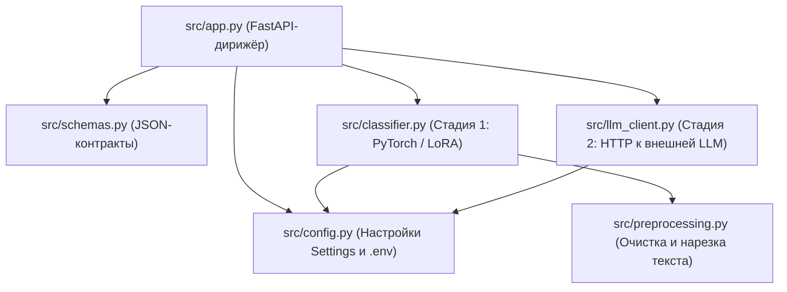
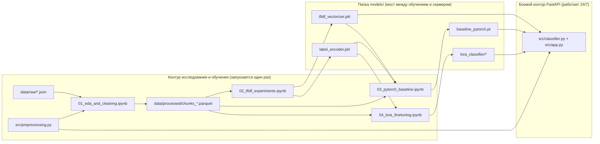
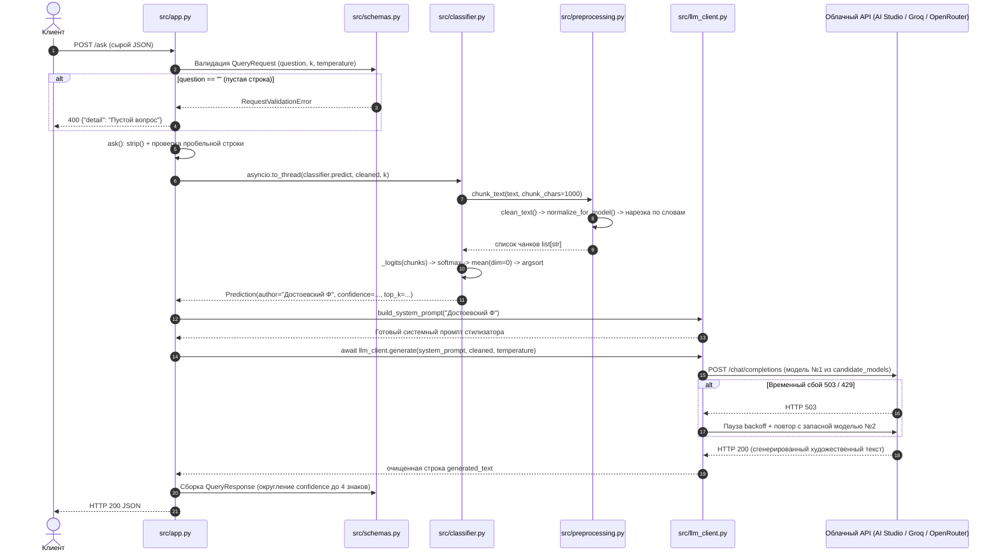
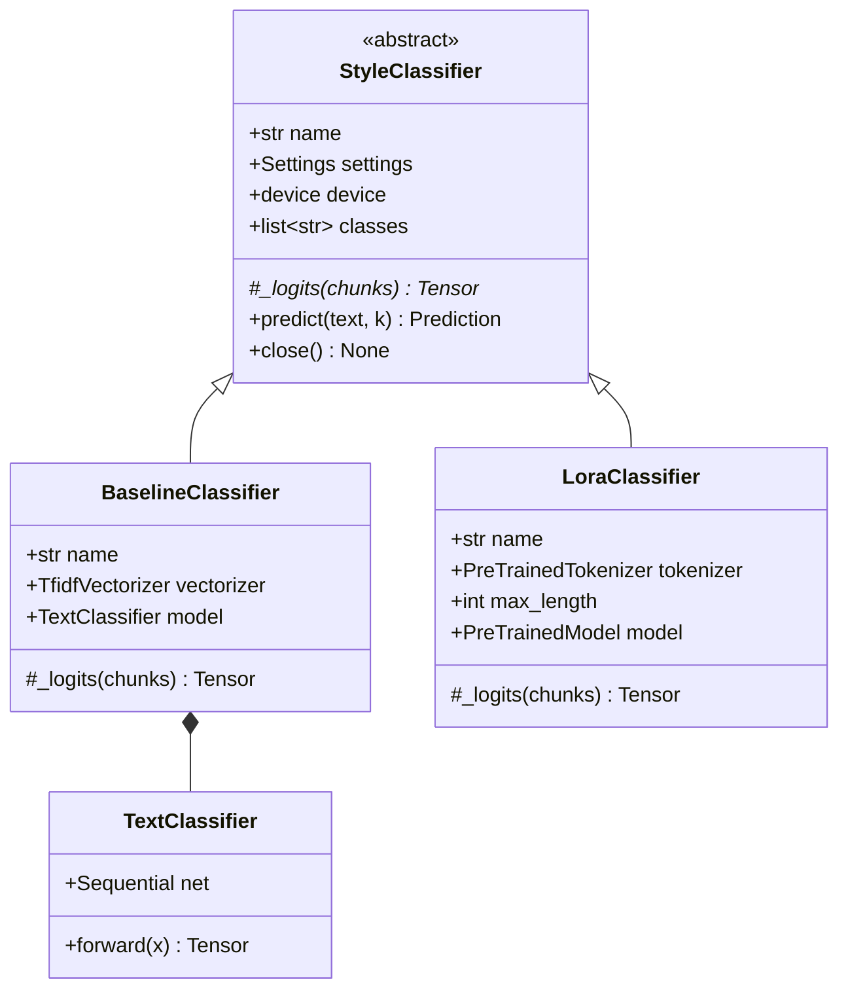

# Полное устройство кодовой базы: структура, принципы работы и взаимосвязь всех частей кода

Этот документ — подробный технический справочник («карта кода») по проекту **Literary Style Assistant**. В нём последовательно разобраны:
1. **Полная структура файлов и папок проекта** (что где лежит и зачем нужен каждый файл).
2. **Принципы проектирования** (почему код написан и разделён именно так).
3. **Полная взаимосвязь всех частей кода** (кто кого импортирует, как связаны ноутбуки обучения с боевым сервером и что происходит по шагам внутри одного HTTP-запроса).
4. **Детальный поблочный разбор каждого файла в `src/`** (все классы, функции, свойства и алгоритмы с точными ссылками на строки).
5. **Разбор исследовательских ноутбуков `notebooks/`, артефактов `models/`, тестов `tests/` и инфраструктурных файлов.**
6. **Сводная матрица вызовов («Кто кого вызывает»).**

---

## 1. Полная структура проекта и назначение каждого файла

Корень проекта: `literary-style-assistant`

```text
literary-style-assistant/
│
├── src/                                  # БОЕВОЙ КОД МИКРОСЕРВИСА (Production Runtime)
│   ├── __init__.py                       # Маркер Python-пакета src
│   ├── preprocessing.py                  # Очистка, нормализация, парсинг авторов и нарезка на чанки
│   ├── config.py                         # Чтение настроек из .env/окружения и автовыбор LLM-провайдера
│   ├── schemas.py                        # Pydantic-контракты входных JSON-запросов и ответов API
│   ├── classifier.py                     # Нейросетевые классификаторы стиля (Baseline MLP и ruBERT+LoRA)
│   ├── llm_client.py                     # Асинхронный HTTP-клиент к облачным LLM с ретраями и fallback
│   └── app.py                            # Точка входа FastAPI: lifespan памяти, роуты /health, /classify, /ask
│
├── models/                               # ОБУЧЕННЫЕ АРТЕФАКТЫ МОДЕЛЕЙ (загружаются сервером при старте)
│   ├── tfidf_vectorizer.pkl              # Обученный посимвольный TF-IDF векторизатор (char 2..4, 50k фич)
│   ├── label_encoder.pkl                 # Кодировщик имён всех 64 авторов (индекс 0..63 <-> имя автора)
│   ├── baseline_pytorch.pt               # Веса (state_dict) и метаданные PyTorch MLP-классификатора
│   └── lora_classifier/                  # Папка дообученного трансформера ruBERT-base + LoRA
│       ├── adapter_config.json           # Конфигурация PEFT LoRA (r=16, alpha=32, target_modules)
│       ├── adapter_model.safetensors     # Обученные веса LoRA-адаптера и головы классификации (9.30 МБ)
│       ├── labels.json                   # Список 64 авторов, max_length=256 и имя базовой модели
│       ├── tokenizer.json                # Быстрый WordPiece-токенизатор для ruBERT-base
│       ├── tokenizer_config.json         # Служебные настройки спецтокенов ([CLS], [SEP], [PAD])
│       └── README.md                     # Автоматическая карточка модели PEFT
│
├── notebooks/                            # КОНВЕЙЕР ИССЛЕДОВАНИЯ И ОБУЧЕНИЯ (создаёт файлы в data/ и models/)
│   ├── 01_eda_and_cleaning.ipynb         # Скачивание JSONL, парсинг, очистка, EDA, нарезка -> data/processed/
│   ├── 02_tfidf_experiments.ipynb        # Сравнение с pymorphy3, Grid Search 36 схем -> tfidf_vectorizer.pkl
│   ├── 03_pytorch_baseline.ipynb         # Обучение TextClassifier (20 эпох) -> baseline_pytorch.pt
│   └── 04_lora_finetuning.ipynb          # Дообучение ruBERT-base + LoRA (BF16) -> models/lora_classifier/
│
├── data/                                 # ДАННЫЕ ОБУЧЕНИЯ (исключены из Git и Docker)
│   ├── raw/                              # Сырые train_dataset.json, validation_dataset.json, test_dataset.json
│   └── processed/                        # Очищенные документы (parsed_*.parquet) и чанки (chunks_*.parquet)
│
├── tests/                                # АВТОМАТИЧЕСКИЕ ТЕСТЫ (22 теста, 99% покрытия src/)
│   ├── __init__.py                       # Описание тестового пакета
│   ├── test_preprocessing.py             # Юнит-тесты очистки, парсинга 4 шаблонов авторов и чанкинга
│   ├── test_config_and_llm.py            # Юнит-тесты Settings, автовыбора провайдеров, ретраев и ошибок LLM
│   ├── test_classifiers.py               # Проверка целостности весов в models/ и инференса обеих моделей
│   └── test_api_and_e2e.py               # Интеграционные тесты FastAPI + живой сквозной E2E-тест с облаком
│
├── reports/                              # МЕТРИКИ, ПРОТОКОЛЫ ЭКСПЕРИМЕНТОВ И ГРАФИКИ
│   ├── tfidf_grid_search.csv             # Таблица результатов перебора 36 конфигураций TF-IDF
│   ├── baseline_history.csv              # Поэпоховая история loss/accuracy/Macro-F1 для PyTorch MLP
│   ├── lora_history.csv                  # История обучения и валидации ruBERT-base + LoRA
│   ├── lora_per_class_report.csv         # Precision / Recall / F1 по каждому из авторов на тесте
│   ├── metrics_baseline.json             # Итоговые метрики и замеры задержки (CPU/GPU) для Baseline
│   ├── metrics_lora.json                 # Итоговые метрики и замеры задержки (CPU/GPU) для LoRA
│   ├── short_length_ablation.json        # Исследование точности на коротких фразах (100 / 250 / 500 / 1000 симв.)
│   ├── live_e2e_samples.json             # Реальные ответы сервиса на живых тестах с Google AI Studio
│   └── figures/                          # Сохранённые графики (.png): распределения, heatmap, кривые, матрицы
│
├── docs/                                 # ДОКУМЕНТАЦИЯ ПРОЕКТА
│   ├── USER_GUIDE.md                     # Простое объяснение и подробная инструкция пользователя
│   ├── CODEBASE_ARCHITECTURE.md          # Этот файл: полный разбор архитектуры и всех частей кода
│   └── TECHNICAL_DOCUMENTATION.md        # Инженерная спецификация API, конфигурации и эксплуатации
│
├── .env                                  # Локальный секретный файл с LLM_API_KEY (НЕ попадает в Git/Docker)
├── .env.example                          # Безопасный шаблон настроек без секретов
├── .gitignore                            # Правила исключения секретов, данных и кэшей из Git
├── .dockerignore                         # Правила исключения лишних папок и .env при сборке Docker-образа
├── Dockerfile                            # Инструкция сборки легковесного CPU-контейнера сервиса
├── requirements.txt                      # Список всех Python-зависимостей с минимальными версиями
├── README.md                             # Главная обзорная страница репозитория
└── REPORT.md                             # Полный аналитический отчёт по машинному обучению и метрикам
```

---

## 2. Ключевые принципы работы и архитектуры кода

Вся кодовая база спроектирована вокруг **шести инженерных принципов**:

1. **Единство предобработки при обучении и в бою (Zero Train-Serving Skew).**
   Ноутбуки обучения (`notebooks/01..04`) не содержат «своих копий» функций очистки и нарезки текста — они напрямую импортируют функции из боевого модуля [preprocessing.py](../src/preprocessing.py). Благодаря этому сервер на инференсе обрабатывает пользовательскую строку **байт-в-байт так же**, как обрабатывались книги во время обучения.
2. **Строгое разделение ответственности (Layered Architecture).**
   Каждый из 6 файлов в `src/` решает ровно одну задачу и ничего не знает о деталях соседних уровней:
   * `config.py` знает только о настройках и переменных окружения;
   * `schemas.py` знает только о структуре входного/выходного JSON;
   * `preprocessing.py` работает только с чистыми строками Python;
   * `classifier.py` отвечает только за математику PyTorch/Transformers (Стадия 1);
   * `llm_client.py` отвечает только за сетевой поход во внешний API (Стадия 2);
   * `app.py` выступает «дирижёром», соединяющим их в HTTP-маршрутах.
3. **Единоразовая загрузка моделей в память (`lifespan`).**
   Веса нейросетей весят сотни мегабайт. Если загружать их с диска при каждом запросе пользователя, каждый ответ занимал бы по 3–5 секунд. Вместо этого контекстный менеджер [`lifespan()`](../src/app.py#L36-L65) загружает векторизатор, классификатор и пул HTTP-соединений **один раз при запуске сервера** в `app.state`, а при выключении аккуратно освобождает RAM и видеопамять CUDA.
4. **Неблокирующая асинхронность (`asyncio.to_thread` + `threading.Lock`).**
   Веб-сервер FastAPI работает в асинхронном цикле событий (`event loop`). Вызов внешней LLM по сети ждёт ответа асинхронно (`await httpx.AsyncClient.post(...)`), не блокируя соседние запросы. А тяжёлое матричное вычисление локальной нейросети выносится из главного потока через [`asyncio.to_thread()`](../src/app.py#L111) и защищается мьютексом `self._lock` внутри [`StyleClassifier.predict()`](../src/classifier.py#L75-L85), чтобы два одновременных запроса не повредили память GPU.
5. **Слияние адаптера LoRA на старте (`merge_and_unload`).**
   При обучении LoRA хранит добавочные матрицы $A$ и $B$ отдельно от базовой модели `ruBERT`. Но при загрузке в [`LoraClassifier.__init__()`](../src/classifier.py#L141) вызывается `.merge_and_unload()`, который математически прибавляет поправку $\frac{\alpha}{r} B A$ прямо в основные матрицы весов `W`. В результате на инференсе остаётся чистый `ruBERT` **с нулевыми накладными расходами** от обёрток PEFT!
6. **Отказоустойчивость внешнего контура и защита секретов.**
   [`LLMClient`](../src/llm_client.py#L39-L121) хранит ключ в обёртке `SecretStr` (чтобы ключ случайно не распечатался в логах при отладке) и умеет переживать временные сбои облака (`429`, `500`, `502`, `503`, `504` и тайм-ауты): делает паузу с экспоненциальным ростом (`1 с → 2 с → 4 с`) и автоматически переключается на запасные модели из кортежа `candidate_models`.

---

## 3. Полная взаимосвязь всех частей кода

### 3.1. Граф импортов между модулями `src/`

Обратите внимание: граф зависимостей строго направлен сверху вниз (нет ни одного циклического импорта):



### 3.2. Связь контура обучения (`notebooks/`) и боевого сервера (`src/`) через `models/`

Ноутбуки и веб-сервер не вызывают друг друга напрямую по сети — они связаны через **общий модуль предобработки** `src/preprocessing.py` и **общую папку обученных артефактов** `models/`:



### 3.3. Пошаговая трассировка одного запроса `POST /ask` через все файлы кода

Проследим, что происходит буквально по секундам и строкам кода, когда клиент отправляет запрос `{"question": "Какая прекрасная ночь над Невой...", "k": 3, "temperature": 0.7}` на `POST /ask`:



1. **Приём и проверка схемы:** Uvicorn передаёт тело запроса в FastAPI ([`app.py`](../src/app.py#L122-L124)). FastAPI проверяет JSON через класс [`QueryRequest`](../src/schemas.py#L8-L11). Если `question == ""`, срабатывает `min_length=1`, который перехватывается функцией [`validation_exception_handler()`](../src/app.py#L78-L86) и превращается в ответ `400 {"detail": "Пустой вопрос"}`.
2. **Защита от пробелов:** Внутри [`ask()`](../src/app.py#L125-L127) вызывается `payload.question.strip()`. Если прислали `"   \n\t  "`, сразу возвращается `400 "Пустой вопрос"`.
3. **Получение загруженных объектов:** [`_require_classifier()`](../src/app.py#L89-L93) и `request.app.state.llm_client` достают из памяти готовый классификатор и HTTP-клиент, созданные ещё при старте сервера в [`lifespan()`](../src/app.py#L36-L65).
4. **Локальная классификация (Стадия 1):** Через `await asyncio.to_thread(classifier.predict, cleaned, payload.k)` вызывается метод [`StyleClassifier.predict()`](../src/classifier.py#L75-L85):
   * он вызывает [`chunk_text()`](../src/preprocessing.py#L73-L98), который внутри вызывает [`normalize_for_model()`](../src/preprocessing.py#L63-L70) → [`clean_text()`](../src/preprocessing.py#L43-L60) и режет текст по словам на куски ~1000 символов (берётся максимум `max_chunks=16` кусков);
   * под блокировкой `with self._lock, torch.inference_mode():` вызывается реализация [`_logits(chunks)`](../src/classifier.py#L150-L157) конкретного бэкенда (`LoraClassifier` или `BaselineClassifier`), возвращающая матрицу сырых оценок размера `[число_чанков, 64]`;
   * `torch.softmax(logits, dim=-1).mean(dim=0)` переводит оценки каждого чанка в вероятности от `0` до `1` и усредняет их по всем чанкам;
   * `np.argsort(-probs)[:k]` сортирует 64 авторов по убыванию вероятности и упаковывает результат в объект [`Prediction`](../src/classifier.py#L47-L51).
5. **Сборка промпта:** [`build_system_prompt(pred.author)`](../src/llm_client.py#L27-L28) подставляет имя найденного классика в шаблон `SYSTEM_PROMPT_TEMPLATE`.
6. **Генерация текста во внешней LLM (Стадия 2):** [`await llm_client.generate(...)`](../src/llm_client.py#L66-L118) берёт список моделей из [`Settings.resolved_candidate_models`](../src/config.py#L110-L116) и отправляет JSON `POST /chat/completions` во внешний сервис (Google AI Studio / Groq / OpenRouter). Если возникла сетевая ошибка, срабатывает `LLMError`, который в [`ask()`](../src/app.py#L141-L142) переводится в корректный HTTP-код (`502`, `503` или `504`).
7. **Формирование ответа:** Результат упаковывается в [`QueryResponse`](../src/schemas.py#L19-L23) и уходит клиенту со статусом `200 OK`.

---

## 4. Детальный разбор каждого файла в `src/`

### 4.1. Пакетный маркер `src/__init__.py`
* **Файл:** [`__init__.py`](../src/__init__.py)
* **Что делает:** Пустой файл, обозначающий папку `src` как полноценный Python-пакет, чтобы импорты вида `from src.config import Settings` одинаково работали из `uvicorn`, `pytest`, Docker и Jupyter-ноутбуков.

---

### 4.2. Модуль предобработки `src/preprocessing.py`
* **Файл:** [preprocessing.py](../src/preprocessing.py) (`118` строк)
* **Роль:** Единая фабрика очистки текста, парсинга исходного датасета и нарезки длинных произведений. Не зависит ни от каких внешних библиотек (только стандартная библиотека Python `json`, `re`, `pathlib`).

#### Константы и регулярные выражения (`L15–L34`)
* [`AUTHOR_RE_PRIMARY`](../src/preprocessing.py#L15) — основное регулярное выражение `r'стиле автора ([^"]+)'` для поиска фразы *«Напиши текс в стиле автора ...»* (покрывает ~20.4% строк датасета).
* [`AUTHOR_RE_FALLBACK`](../src/preprocessing.py#L21) — резервное выражение `r'автора\s+([^"]+?)\s*$'`. Нужен потому, что в датасете есть ещё 3 формулировки (*«Придумай отрывок из книги ... автора Толстой Л»*, *«Напиши текс похожий на текст автора Чехов А»* и т.д.). Вместе два выражения извлекают автора из **100% записей** без потери классов.
* [`_LITERAL_ESCAPES`](../src/preprocessing.py#L23-L30) — таблица замен для «битых» двойных экранирований из сырого JSON (когда в строке буквально записаны два символа `\n` или `\"` вместо настоящего переноса строки или кавычки).
* [`_CONTROL_RE`](../src/preprocessing.py#L34) — удаляет невидимые управляющие ASCII-байты (`\x00–\x1f`), нулевой пробел `\u200b` и маркер BOM `\ufeff` (именно удаление без замены на пробел важно, чтобы перед точкой не появлялся лишний пробел `"слово ."`).
* [`_SPACES_RE`](../src/preprocessing.py#L31), [`_MULTI_NL_RE`](../src/preprocessing.py#L32), [`_WS_RE`](../src/preprocessing.py#L33) — скомпилированные выражения для схлопывания повторяющихся пробелов, неразрывных пробелов `\u00a0` и пустых строк.

#### Функции модуля
* [`extract_author(user_message)`](../src/preprocessing.py#L37-L40) — принимает реплику роли `"user"` из датасета и возвращает чистое имя писателя (например, `"Достоевский Ф"`) или `None`. Вызывается внутри `parse_record()`.
* [`clean_text(text)`](../src/preprocessing.py#L43-L60) — чистит сырой художественный отрывок: исправляет битые экранирования, приводит переводы строк к `\n`, вырезает управляющий мусор, убирает повторные пробелы и пустые абзацы, сохраняя при этом нормальные одиночные `\n`. Используется в ноутбуке `01` и внутри `normalize_for_model()`.
* [`normalize_for_model(text)`](../src/preprocessing.py#L63-L70) — вызывает `clean_text(text)`, а затем заменяет любые переводы строк на обычный пробел. Зачем: в датасете разрывы строк стояли там, где версталась старая электронная книга, а живой пользователь в API обычно присылает абзац одной строкой. Чтобы модель не «привязывалась» к артефактам книжной вёрстки, все пробельные символы приводятся к единому виду.
* [`chunk_text(text, chunk_chars=1000, min_chars=200)`](../src/preprocessing.py#L73-L98) — ключевая функция нарезки текста:
  1. Нормализует текст через `normalize_for_model(text)` и делит по пробелам на список слов (никакое слово никогда не разрезается пополам!).
  2. Накапливает слова в буфер `current`, пока суммарная длина не достигнет `chunk_chars` (по умолчанию `1000` символов), после чего сохраняет готовый чанк.
  3. Если в самом конце остался короткий «хвостик» меньше `min_chars` (`200` символов), он не выбрасывается и не остаётся слишком коротким огрызком, а приклеивается к последнему полноценному чанку (`chunks[-1]`). Если же весь присланный пользователем запрос изначально короткий (например, фраза из 35 символов), он целиком возвращается как единственный элемент списка `[tail]`. Если строка пустая — возвращает `[]`.
* [`iter_jsonl(path)`](../src/preprocessing.py#L101-L107) — ленивый генератор (`yield`), читающий большие файлы `*_dataset.json` построчно без загрузки сотен мегабайт в память разом. Используется в ноутбуке `01`.
* [`parse_record(record)`](../src/preprocessing.py#L110-L118) — разбирает диалоговый словарь `{"messages": [{"role": "system", ...}, {"role": "user", ...}, {"role": "assistant", ...}]}` и возвращает кортеж `(автор, текст_произведения)`.

---

### 4.3. Модуль конфигурации `src/config.py`
* **Файл:** [config.py](../src/config.py) (`121` строка)
* **Роль:** Централизованное хранилище всех настроек сервиса на базе `pydantic-settings`.

* [`PROJECT_ROOT`](../src/config.py#L16) — автоматически вычисляет абсолютный путь к корню репозитория (`Path(__file__).resolve().parent.parent`), поэтому проект работает независимо от текущей папки запуска.
* [`PROVIDER_DEFAULTS`](../src/config.py#L18-L34) — встроенный справочник стандартных URL, основных и резервных (`fallback_models`) моделей для трёх облачных платформ:
  * `"groq"` → `https://api.groq.com/openai/v1`, модель `llama-3.1-8b-instant`;
  * `"openrouter"` → `https://openrouter.ai/api/v1`, модель `meta-llama/llama-3.3-70b-instruct:free`;
  * `"aistudio"` → `https://generativelanguage.googleapis.com/v1beta/openai`, основная модель `gemini-3.1-flash-lite` + резервная цепочка `("gemini-flash-lite-latest", "gemma-4-31b-it")`.
* Класс [`Settings(BaseSettings)`](../src/config.py#L37-L117):
  * Автоматически читает переменные окружения ОС и файл `.env` в кодировке UTF-8, игнорируя лишние системные переменные (`extra="ignore"`).
  * Хранит `llm_api_key` в типе `SecretStr | None` (при выводе объекта `Settings` в консоль ключ маскируется звёздочками `**********`).
  * Свойства путей (`vectorizer_path`, `label_encoder_path`, `baseline_path`, `lora_dir`, `base_model_dir` на строках `L71–L89`) строят точные пути ко всем файлам внутри `models/`.
  * [`resolved_provider`](../src/config.py#L91-L100) — умный детектор провайдера: если стоит `llm_provider="auto"`, смотрит на первые символы ключа (`sk-or-` → `"openrouter"`, `AQ.` или `AIza` → `"aistudio"`, иначе `"groq"`).
  * [`resolved_base_url`](../src/config.py#L102-L104) и [`resolved_model`](../src/config.py#L106-L108) — возвращают либо ручное переопределение пользователя из `.env`, либо стандартное значение провайдера из `PROVIDER_DEFAULTS`.
  * [`resolved_candidate_models`](../src/config.py#L110-L116) — собирает кортеж моделей по порядку приоритета `(основная, резервная_1, резервная_2)` без дублей.
* [`get_settings()`](../src/config.py#L119-L121) — обёрнута в `@lru_cache`, чтобы файл `.env` читался с диска один раз, а не при каждом вызове.

---

### 4.4. Модуль контрактов данных `src/schemas.py`
* **Файл:** [schemas.py](../src/schemas.py) (`35` строк)
* **Роль:** Описывает строгие схемы входных и выходных JSON-сообщений с помощью `pydantic.BaseModel` (именно по этим классам FastAPI проверяет типы данных и автоматически рисует страницу `http://localhost:8000/docs`).

* [`QueryRequest`](../src/schemas.py#L8-L11) — входной JSON для `/classify` и `/ask`:
  * `question: str` — обязательное поле (`min_length=1`);
  * `k: int = 3` — ограничено диапазоном `ge=1, le=10`;
  * `temperature: float = 0.7` — ограничено диапазоном `ge=0.0, le=2.0`.
* [`AuthorScore`](../src/schemas.py#L14-L16) — один элемент рейтинга (`author`, `probability`).
* [`QueryResponse`](../src/schemas.py#L19-L23) — ответ `/ask` (`predicted_author`, `confidence`, `model_name`, `generated_text`).
* [`ClassifyResponse`](../src/schemas.py#L26-L30) — ответ `/classify` (`predicted_author`, `confidence`, `model_name`, `top_authors: list[AuthorScore]`).
* [`HealthResponse`](../src/schemas.py#L33-L35) — ответ `/health` (`status`, `model_loaded`).

---

### 4.5. Модуль нейросетевой классификации `src/classifier.py`
* **Файл:** [classifier.py](../src/classifier.py) (`170` строк)
* **Роль:** Полная реализация **Стадии 1** (локальное распознавание автора текста на PyTorch). Построен на классическом паттерне проектирования **«Шаблонный метод» (Template Method)** + **«Фабрика» (Factory)**.



* [`TextClassifier(nn.Module)`](../src/classifier.py#L32-L44) — архитектура полносвязной нейросети для `baseline`: `Linear(50000 -> 128) -> ReLU -> Linear(128 -> 64)`. Важная деталь: на выходе сети намеренно **нет слоя `Softmax`** — она возвращает сырые логиты, так как при обучении функция потерь `nn.CrossEntropyLoss` сама применяет численно устойчивый `LogSoftmax` внутри себя, а на инференсе `torch.softmax` применяется уже в общем методе `predict()`.
* [`Prediction`](../src/classifier.py#L47-L51) — компактный `@dataclass` с результатами предсказания: `author` (лучший автор), `confidence` (его вероятность), `top_k` (список пар `(автор, вероятность)`).
* [`resolve_device(name)`](../src/classifier.py#L54-L57) — переводит строку `"auto"` в `torch.device("cuda")`, если доступна видеокарта NVIDIA, иначе в `torch.device("cpu")`.
* Абстрактный базовый класс [`StyleClassifier(ABC)`](../src/classifier.py#L60-L95):
  * Хранит общую логику для **любого** классификатора, чтобы не дублировать код.
  * Абстрактный метод [`_logits(chunks)`](../src/classifier.py#L71-L73) — единственное, что обязан реализовать наследник: принять список текстовых чанков и вернуть тензор сырых логитов `[n_chunks, 64]`.
  * Метод [`predict(text, k=3)`](../src/classifier.py#L75-L85) — нарезает текст через `chunk_text()`, ограничивает число кусков до `settings.max_chunks`, под потоковой блокировкой `self._lock` и без расчёта градиентов (`torch.inference_mode()`) вызывает `self._logits(chunks)`, переводит логиты в вероятности через `torch.softmax(..., dim=-1)`, усредняет по чанкам (`.mean(dim=0)`), находит топ-`k` индексов и возвращает `Prediction`.
  * Метод [`close()`](../src/classifier.py#L87-L94) — обнуляет ссылки на тяжёлые объекты (`model`, `vectorizer`, `tokenizer`), вызывает сборщик мусора `gc.collect()` и сбрасывает кэш видеопамяти `torch.cuda.empty_cache()`.
* [`BaselineClassifier(StyleClassifier)`](../src/classifier.py#L97-L116):
  * В `__init__` подхватывает переданный `tfidf_vectorizer.pkl` (или загружает сам через `joblib`), безопасно читает чекпоинт `models/baseline_pytorch.pt` (`weights_only=True`), воссоздаёт `TextClassifier(50000, 64)`, заливает в него веса `load_state_dict()`, переносит на `device` и включает режим `.eval()`.
  * В `_logits(chunks)` превращает строки в разреженную матрицу символьных n-грамм `self.vectorizer.transform(chunks)`, переводит в плотный тензор PyTorch и прогоняет через `self.model(x)`.
* [`LoraClassifier(StyleClassifier)`](../src/classifier.py#L119-L157):
  * В `__init__` делает ленивый импорт `peft` и `transformers` (благодаря этому в режиме `baseline` тяжёлые библиотеки трансформеров даже не тратят время на импорт!), читает `models/lora_classifier/labels.json`, загружает токенизатор и базовый `ai-forever/ruBert-base` (из локальной папки `models/rubert_base`, если она есть, иначе из кэша Hugging Face), накладывает сверху адаптер `PeftModel.from_pretrained(...)` и вызывает **`.merge_and_unload()`**, сливая адаптер с базовой моделью.
  * В `_logits(chunks)` токенизирует сразу всю пачку чанков батчем с дополнением до одной длины (`padding=True, truncation=True, max_length=256`). Если вычисление идёт на видеокарте CUDA, включает аппаратное ускорение половинной точности `torch.autocast("cuda", dtype=torch.bfloat16)`.
* Фабричная функция [`load_classifier(settings, vectorizer=None)`](../src/classifier.py#L160-L170) — выбирает и создаёт нужный класс по настройке `settings.classifier_backend`. Если выбран `"lora"`, но папка адаптера почему-то отсутствует на диске, сервис не упадёт при запуске, а запишет предупреждение в лог и мягко переключится на резервный `BaselineClassifier`!

---

### 4.6. Модуль клиента внешней генерации `src/llm_client.py`
* **Файл:** [llm_client.py](../src/llm_client.py) (`121` строка)
* **Роль:** Полная реализация **Стадии 2** — общение с внешними облачными LLM по единому OpenAI-совместимому протоколу `POST /chat/completions`.

* [`SYSTEM_PROMPT_TEMPLATE`](../src/llm_client.py#L18-L24) и [`build_system_prompt(predicted_author)`](../src/llm_client.py#L27-L28) — формируют жёсткую системную инструкцию для внешней модели: представиться стилизатором найденного писателя, воспроизвести его лексику, синтаксис и пунктуацию и **не писать отсебятину ассистента** (*«Конечно! Вот ваш текст:»*).
* [`LLMError(Exception)`](../src/llm_client.py#L31-L36) — специализированное исключение, несущее кроме текста ошибки ещё и точный HTTP-статус (`status_code`: `502`, `503` или `504`), который нужно вернуть клиенту.
* Класс [`LLMClient`](../src/llm_client.py#L39-L121):
  * В [`__init__()`](../src/llm_client.py#L44-L58) создаёт долгоживущий пул соединений `httpx.AsyncClient` с заголовком `Authorization: Bearer <ключ>`, тайм-аутом подключения `10 с` и общим тайм-аутом `settings.llm_timeout` (`25 с`). Для провайдера OpenRouter дополнительно прикрепляет рекомендованный заголовок `X-Title: Literary Style Assistant`.
  * Свойство [`configured`](../src/llm_client.py#L60-L64) — проверяет, передан ли непустой API-ключ.
  * Асинхронный метод [`generate(system_prompt, user_message, temperature=0.7)`](../src/llm_client.py#L66-L118) — реализует отказоустойчивый цикл обращения к API:
    * Если ключ не задан (`not self.configured`) — мгновенно бросает `LLMError(..., status_code=503)`.
    * Вычисляет число попыток `total_attempts = max(llm_max_retries + 1, len(candidate_models))`. На каждой следующей попытке берёт следующую запасную модель из `self.candidate_models` (например, если в Google AI Studio перегружена первая модель, вторая попытка автоматически уйдёт уже на резервную модель!).
    * При `HTTP 200` достаёт `data["choices"][0]["message"]["content"]`, проверяет, что текст не пустой, и возвращает его.
    * При `HTTP 401` или `403` (неверный ключ) **не тратит время на ретраи**, а сразу прерывает цикл с ошибкой `502`.
    * При временных кодах из `RETRY_STATUSES = (429, 500, 502, 503, 504)` или сетевых обрывах ждёт `1.0 * 2**attempt` секунд (`1 с`, затем `2 с`...) и повторяет попытку. Если все попытки исчерпаны, бросает `LLMError` с кодом `504` (если был тайм-аут) или `502`.
  * [`aclose()`](../src/llm_client.py#L120-L121) — корректно закрывает TCP/TLS-соединения при остановке сервера.

---

### 4.7. Главный модуль веб-сервера `src/app.py`
* **Файл:** [app.py](../src/app.py) (`149` строк)
* **Роль:** Главная точка входа FastAPI (`src.app:app`), связывающая конфигурацию, схемы, классификатор и LLM-клиент в готовый HTTP-сервис.

* [`lifespan(app)`](../src/app.py#L35-L65) — асинхронный менеджер жизненного цикла приложения:
  * **До `yield` (при старте сервера):** читает `get_settings()`, загружает `tfidf_vectorizer.pkl` (если он есть), инициализирует классификатор через `load_classifier()`, создаёт `LLMClient(settings)` и сохраняет всё в `app.state`.
  * **В блоке `finally` (при нажатии `Ctrl+C` или остановке контейнера):** закрывает сетевой клиент `await llm_client.aclose()`, выгружает нейросеть `classifier.close()`, очищает ссылки в `app.state`, запускает `gc.collect()` и освобождает кэш видеокарты `torch.cuda.empty_cache()`.
* [`app = FastAPI(...)`](../src/app.py#L67-L75) — само ASGI-приложение с метаданными для Swagger UI и подключённым `lifespan`.
* [`validation_exception_handler(_request, exc)`](../src/app.py#L78-L86) — перехватчик ошибок валидации Pydantic. По умолчанию FastAPI на пустую строку `{"question": ""}` вернул бы стандартный код `422`. Этот обработчик проверяет список ошибок: если проблема именно в `string_too_short` поля `question`, он возвращает строго требуемый по ТЗ статус **`400` с текстом `{"detail": "Пустой вопрос"}`**, а для всех прочих нарушений схемы (например, `k: 0` или отсутствие JSON) оставляет честный код `422`.
* [`_require_classifier(request)`](../src/app.py#L89-L93) — защитная функция: проверяет, что `app.state.classifier` загружен, иначе отдаёт `503 "Модель классификатора не загружена"`.
* Три маршрута (эндпоинта):
  * [`GET /health`](../src/app.py#L96-L100) — мгновенно проверяет `app.state.classifier is not None` и возвращает `HealthResponse(status="ok", model_loaded=...)`.
  * [`POST /classify`](../src/app.py#L103-L119) — проверяет непустоту строки после `.strip()`, выполняет `await asyncio.to_thread(classifier.predict, cleaned, payload.k)` и возвращает `ClassifyResponse` с топ-`k` авторами (без обращения во внешний LLM API).
  * [`POST /ask`](../src/app.py#L122-L149) — выполняет полный двухстадийный пайплайн: локальное предсказание автора в пуле потоков → `build_system_prompt()` → асинхронный `await llm_client.generate()` → возврат `QueryResponse`.

---

## 5. Разбор исследовательских ноутбуков (`notebooks/`) и артефактов (`models/`)

| Ноутбук | Что делает внутри по шагам | Что читает на входе | Какие файлы создаёт на выходе |
| :--- | :--- | :--- | :--- |
| [01_eda_and_cleaning.ipynb](../notebooks/01_eda_and_cleaning.ipynb) | 1. Скачивает 3 сплита с Hugging Face.<br>2. Извлекает авторов и тексты через `parse_record()` из `src/preprocessing.py` (100% покрытие всех 4 шаблонов, 64 автора).<br>3. Очищает тексты (`clean_text`), проверяет отсутствие пересечений между сплитами (`0` утечек).<br>4. Строит гистограммы баланса классов и длин текстов.<br>5. Режет произведения на чанки ~1000 символов (`chunk_text`): `110 285` train / `9 735` val / `9 748` test. | `data/raw/*.json`, `src/preprocessing.py` | `data/processed/parsed_*.parquet`, `data/processed/chunks_*.parquet`, графики в `reports/figures/` |
| [02_tfidf_experiments.ipynb](../notebooks/02_tfidf_experiments.ipynb) | 1. Замеряет скорость и качество морфологической лемматизации `pymorphy3` против «сырых» символьных n-грамм.<br>2. Проводит Grid Search по 36 комбинациям (`analyzer`, `ngram_range`, `max_features`, `sublinear_tf`).<br>3. Доказывает превосходство `char (2, 4)` с `sublinear_tf=True` и `50 000` признаков.<br>4. Обучает финальный векторизатор и кодировщик меток. | `data/processed/chunks_*.parquet` | `models/tfidf_vectorizer.pkl`, `models/label_encoder.pkl`, `reports/tfidf_grid_search.csv` |
| [03_pytorch_baseline.ipynb](../notebooks/03_pytorch_baseline.ipynb) | 1. Векторизует корпус в 8 потоков.<br>2. Делит данные через `GroupShuffleSplit` по `doc_id` (чтобы куски одной книги не попали одновременно в train и val!).<br>3. Обучает `TextClassifier` (`50000 -> 128 -> 64`, без `Softmax`) 20 эпох с `Adam` и `CrossEntropyLoss`.<br>4. Оценивает точность по чанкам (`94.35%`) и по целым книгам (`99.29%`), замеряет латентность CPU/GPU. | `models/tfidf_vectorizer.pkl`, `models/label_encoder.pkl`, `chunks_*.parquet` | `models/baseline_pytorch.pt`, `reports/metrics_baseline.json`, `reports/baseline_history.csv` |
| [04_lora_finetuning.ipynb](../notebooks/04_lora_finetuning.ipynb) | 1. Загружает `ai-forever/ruBert-base` и оборачивает слои `query`, `value`, `dense` адаптером PEFT LoRA (`r=16, alpha=32`, обучается 1.35% параметров).<br>2. Обучает 4 эпохи в `BF16` с косинусным расписанием шага на всех 110 285 чанках.<br>3. Считает метрики чанков (`91.72%`) и полных документов (`99.15%` Acc, **`98.53%` Macro-F1**), строит матрицу ошибок. | `chunks_*.parquet`, `models/label_encoder.pkl`, `ai-forever/ruBert-base` | `models/lora_classifier/*`, `reports/metrics_lora.json`, `reports/lora_per_class_report.csv` |

---

## 6. Разбор автоматических тестов (`tests/`) и инфраструктурных файлов

### 6.1. Тестовый пакет `tests/`
Каждый тестовый файл прицельно проверяет свой слой архитектуры:

1. [test_preprocessing.py](../tests/test_preprocessing.py) (`PreprocessingUnitTests`):
   * проверяет извлечение автора из всех 4 шаблонов датасета (`Платонов С`, `Толстой Л`, `Достоевский Ф`, `Салтыков-Щедрин М`, `Горький Максим`) и возврат `None` на обычном вопросе;
   * проверяет очистку битых экранирований `\\r\\n`, `\\"`, управляющих байтов `\x00`, `\u200b` и неразрывных пробелов;
   * проверяет склейку короткого хвоста в `chunk_text()`, сохранение короткой одиночной фразы и чтение `.jsonl`.
2. [test_config_and_llm.py](../tests/test_config_and_llm.py) (`ConfigResolutionTests` + `LLMClientUnitTests`):
   * проверяет автоопределение `gsk_` → `groq`, `sk-or-` → `openrouter`, `AQ.`/`AIza` → `aistudio` и приоритет ручных переопределений;
   * с помощью виртуального транспорта `httpx.MockTransport` (без выхода в интернет!) моделирует все нештатные ситуации облака: отсутствие ключа (`503`), перегрузку первой модели `503` с успешным переключением на вторую модель из `candidate_models`, неверный ключ `401` (мгновенный отказ без ретраев), тайм-аут чтения (`504`), обрыв соединения (`ConnectError -> 502`) и битый JSON ответа (`502`).
3. [test_classifiers.py](../tests/test_classifiers.py) (`ClassifierAndArtifactTests`):
   * проверяет структуру слоёв `TextClassifier`, отсутствие `Softmax` внутри сети и прохождение градиентов `loss.backward()`;
   * проверяет физическую целостность всех обученных файлов в `models/` (50 000 фич у векторизатора, 64 класса, 20 эпох в чекпоинте, `r=16, lora_alpha=32` в `adapter_config.json`);
   * прогоняет реальный инференс **обеих** моделей (`baseline` и `lora`) на длинном многочанковом тексте и проверяет сортировку вероятностей и очистку памяти `close()`.
4. [test_api_and_e2e.py](../tests/test_api_and_e2e.py) (`FastAPIIntegrationTests`):
   * `test_health_validation_and_error_handling` поднимает `TestClient(app)` с подставными `DummyClassifier` и `MockLLM`, проверяя `/health`, код `400 "Пустой вопрос"` на `""` и пробелах, код `422` на неверных `k`/`temperature`, работу `/classify` и `/ask`, проброс `504` от LLM и код `503` при выгруженной модели;
   * `test_live_e2e_with_real_lora_and_configured_llm_api` запускает **полностью настоящий сервер** с реальным `ruBERT-base + LoRA` и живым запросом по интернету в облачный API из `.env`!

### 6.2. Инфраструктурные файлы в корне проекта
* [Dockerfile](../Dockerfile) — собирает контейнер на базе `python:3.11-slim` в 3 шага:
  1. Копирует только `requirements.txt`, ставит лёгкую **CPU-версию PyTorch** (экономия ~2.5 ГБ относительно CUDA-образа), ставит остальные пакеты и заранее скачивает базовые веса `ai-forever/ruBert-base` внутрь слоя образа (чтобы контейнер в продакшене стартовал мгновенно и не зависел от доступности сайта Hugging Face).
  2. Копирует только папки `src/` и `models/`.
  3. Открывает порт `8000` и запускает `uvicorn src.app:app --host 0.0.0.0 --port 8000`.
* [.dockerignore](../.dockerignore) и [.gitignore](../.gitignore) — гарантируют, что секретный файл `.env`, виртуальное окружение `.venv` и гигабайты сырых текстов `data/` никогда не попадут ни в Git-репозиторий, ни внутрь Docker-образа.

---

## 7. Сводная матрица взаимосвязей («Кто кого вызывает»)

| Модуль и символ | Где объявлен | Кем вызывается | Что сам вызывает внутри себя |
| :--- | :--- | :--- | :--- |
| `extract_author()` | [preprocessing.py](../src/preprocessing.py#L37-L40) | `parse_record()`, `test_preprocessing.py` | `AUTHOR_RE_PRIMARY`, `AUTHOR_RE_FALLBACK` |
| `clean_text()` | [preprocessing.py](../src/preprocessing.py#L43-L60) | `normalize_for_model()`, `01_eda_and_cleaning.ipynb`, тесты | `_LITERAL_ESCAPES`, `_CONTROL_RE`, `_SPACES_RE`, `_MULTI_NL_RE` |
| `normalize_for_model()` | [preprocessing.py](../src/preprocessing.py#L63-L70) | `chunk_text()`, `test_preprocessing.py` | `clean_text()`, `_WS_RE` |
| `chunk_text()` | [preprocessing.py](../src/preprocessing.py#L73-L98) | `StyleClassifier.predict()`, `01_eda_and_cleaning.ipynb`, тесты | `normalize_for_model()` |
| `iter_jsonl()`, `parse_record()` | [preprocessing.py](../src/preprocessing.py#L101-L118) | `01_eda_and_cleaning.ipynb`, `test_preprocessing.py` | `json.loads()`, `extract_author()` |
| `Settings`, `get_settings()` | [config.py](../src/config.py#L37-L121) | `lifespan()` в `app.py`, `StyleClassifier`, `LLMClient`, тесты | Чтение `.env`, `PROVIDER_DEFAULTS` |
| `QueryRequest` и `*Response` | [schemas.py](../src/schemas.py#L8-L35) | Роуты `/health`, `/classify`, `/ask` в `app.py` | Валидаторы `pydantic.Field` |
| `TextClassifier` | [classifier.py](../src/classifier.py#L32-L44) | `BaselineClassifier`, `03_pytorch_baseline.ipynb`, `test_classifiers.py` | `nn.Sequential(Linear, ReLU, Linear)` |
| `StyleClassifier.predict()` | [classifier.py](../src/classifier.py#L75-L85) | `classify()` и `ask()` в `app.py` (через `asyncio.to_thread`) | `chunk_text()`, `self._logits()`, `torch.softmax()` |
| `BaselineClassifier` | [classifier.py](../src/classifier.py#L97-L116) | `load_classifier()`, `test_classifiers.py` | `joblib.load()`, `torch.load()`, `TextClassifier` |
| `LoraClassifier` | [classifier.py](../src/classifier.py#L119-L157) | `load_classifier()`, `test_classifiers.py` | `AutoTokenizer`, `AutoModelForSequenceClassification`, `PeftModel.merge_and_unload()` |
| `load_classifier()` | [classifier.py](../src/classifier.py#L160-L170) | `lifespan()` в `app.py`, `test_classifiers.py` | `LoraClassifier` или `BaselineClassifier` |
| `build_system_prompt()` | [llm_client.py](../src/llm_client.py#L27-L28) | `ask()` в `app.py`, `test_config_and_llm.py` | `SYSTEM_PROMPT_TEMPLATE.format()` |
| `LLMClient.generate()` | [llm_client.py](../src/llm_client.py#L66-L118) | `ask()` в `app.py`, `test_config_and_llm.py` | `httpx.AsyncClient.post()`, `asyncio.sleep()`, `LLMError` |
| `lifespan()` | [app.py](../src/app.py#L35-L65) | FastAPI при запуске и остановке сервера / `TestClient` | `get_settings()`, `joblib.load()`, `load_classifier()`, `LLMClient`, `.close()`, `.aclose()` |
| `health()`, `classify()`, `ask()` | [app.py](../src/app.py#L96-L149) | HTTP-клиенты (браузер, PowerShell, `curl`, Python, `TestClient`) | `_require_classifier()`, `classifier.predict()`, `build_system_prompt()`, `llm_client.generate()` |
